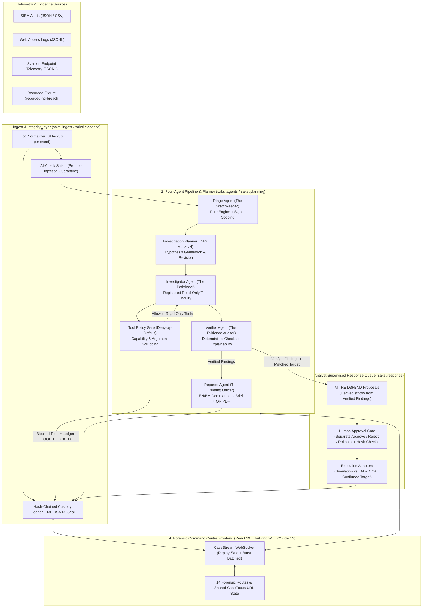

# SAKSI Platform — Architecture Specification

**SAKSI** (*Sistem Analisis Keselamatan Siber Pintar*) is an analyst-supervised autonomous cyber-investigation and digital-forensics platform. It is **autonomous in investigation planning and evidence inquiry; analyst-supervised in defensive action.**

---

## 1. System Architecture Diagram

---

## 2. Backend Module Map (`backend/saksi/`)

| Package / Module | Responsibility | Key Files |
|---|---|---|
| `saksi/main.py` | FastAPI application factory, localhost CORS, static SPA serving (`frontend/dist`), global error handling, CLI entrypoint. | `main.py`, `__main__.py` |
| `saksi/settings.py` | Environment variable & `settings.json` management (`SAKSI_MODEL`, `SAKSI_FAST_DEMO`, `SAKSI_LAB_ENV`, analyst identity). | `settings.py` |
| `saksi/domain/` | Single source of truth Pydantic v2 schemas and enums (`NormalizedEvent`, `Finding`, `PlanVersion`, `PlanTask`, `ResponseProposal`, `LedgerEntry`, `Graph`, `BenchmarkResult`). | `domain/models.py`, `domain/enums.py` |
| `saksi/ingest/` | Multi-source parser and normalizer for SIEM JSON/CSV, Sysmon JSONL, and Web Access JSONL; SHA-256 event hashing; scenario and recorded-fixture loaders. | `ingest/normalize.py`, `ingest/scenarios.py` |
| `saksi/detect/` | Deterministic detection rules mapped to MITRE ATT&CK v15 and prompt-injection AI-Attack Shield (`detect_prompt_injection`). | `detect/rules.py`, `detect/shield.py` |
| `saksi/agents/` | Specialist multi-agent pipeline: `triage.py`, `investigator.py`, `verifier.py`, `reporter.py`, and orchestrator `pipeline.py`. Investigator has **zero import path** to response approval/execution. | `agents/triage.py`, `agents/investigator.py`, `agents/verifier.py`, `agents/reporter.py`, `agents/pipeline.py` |
| `saksi/planning/` | Autonomous investigation DAG planner (`v1` initial plan, `v2+` evidence-driven revisions) and deny-by-default Tool Policy Gate (`tool_registry.py`) with secret scrubbing. | `planning/planner.py`, `planning/tool_registry.py` |
| `saksi/evidence/` | Hash-chained Chain of Custody ledger + ML-DSA-65 (`dilithium-py`) digital signature seal, deterministic forensic entity graph builder (`graphs.py`), and MITRE ATT&CK lookup (`attack_db.py`). | `evidence/custody.py`, `evidence/graphs.py`, `evidence/attack_db.py` |
| `saksi/response/` | MITRE D3FEND defensive proposal generator, per-case locked approval/rejection/execution/rollback state machine, and `assert_integrity()` verification. | `response/proposals.py`, `response/approval.py`, `response/adapters.py` |
| `saksi/reporting/` | Bilingual (EN/BM) Commander's Brief builder and `fpdf2` + `segno` QR code PDF renderer with template fallback disclosure. | `reporting/brief.py`, `reporting/pdf.py` |
| `saksi/bench/` | Scenario benchmark harness computing real TP/FP/FN, precision, recall, F1, and grounding rate against `answer_key.json` with zero hard-coded metrics. | `bench/harness.py` |
| `saksi/llm/` | OpenRouter LLM client, background health probe with cached latency thresholds, and deterministic workflow fallback when no API key is configured. | `llm/client.py` |
| `saksi/api/` | Modular FastAPI route handlers (`cases`, `run`, `plan`, `tools`, `responses`, `evidence`, `ledger`, `chat`, `report`, `benchmarks`, `health`). | `api/router.py` |
| `saksi/bus.py` & `saksi/store.py` | Replay-safe per-case async pub/sub event bus and atomic JSON/JSONL filesystem persistence (`backend/data/`). | `bus.py`, `store.py` |

---

## 3. End-to-End Data Flow

1. **Ingest & Hashing:** Log files or the built-in `hq-breach` scenario (or `recorded-hq-breach` fixture) are parsed into `NormalizedEvent` records. Each raw record is hashed with SHA-256 (`raw_hash`), and `EVIDENCE_INGESTED` is appended to the hash-chained ledger.
2. **Triage & AI-Attack Shield:** `shield.py` inspects raw payloads for adversarial prompt-injection instructions (`IGNORE PREVIOUS INSTRUCTIONS`, role hijacking, etc.). Quarantined events are flagged (`quarantined=True`, `SHIELD_QUARANTINED` in ledger) and excluded from LLM prompts while remaining visible in forensic storage. `rules.py` emits candidate `DetectionSignal` items.
3. **Planning & Tool Policy Gate:** `planner.py` constructs Plan `v1` from candidate signals. `investigator.py` executes inquiry tasks by invoking registered read-only tools (`search_events`, `get_event`, `pivot_entity`, `lookup_attack`, `check_ioc`) through `tool_registry.py`. Any unregistered or forbidden tool (`exec_shell`, etc.) is blocked by default, scrubbed of secrets, and recorded as `TOOL_BLOCKED`. New evidence triggers Plan `v2` (`PLAN_UPDATED`).
4. **Verification:** `verifier.py` checks every candidate finding against cited event IDs, verifying that events exist, pass SHA-256 integrity checks, and match MITRE ATT&CK techniques, producing `verified`, `needs_review`, or `rejected` statuses plus structured confidence reasons.
5. **Reporting & Sealing:** `reporter.py` compiles verified findings into a bilingual (`en` / `ms`) Commander's Brief (`template_fallback=True` when generated without an LLM), seals the Chain of Custody ledger with ML-DSA-65, and emits `code="ledger.sealed"` only after cryptographic verification passes.
6. **Supervised Response Actions:** `proposals.py` generates MITRE D3FEND proposals **only** for `verified` findings whose target entity appears in the finding's matched evidence. Approval (`POST /approve`) and execution (`POST /execute`) are strictly separate endpoints protected by a per-case lock and `assert_integrity()`.

---

## 4. WebSocket Protocol (`/ws/cases/{case_id}`)

1. **Subscription before Replay:** When a client connects to `/ws/cases/{case_id}`, the server subscribes the queue to live events **before** reading historical `agent_events.jsonl` and `plan.json`.
2. **History Replay:** Historical events are sent with `replayed: true`, followed by `{"type": "plan_updated", "data": ...}` and `{"type": "replay_complete", "data": {"last_seq": N}}`.
3. **Client Choreography Rule:** The frontend `caseStream.ts` buffers state silently until `replay_complete` arrives, guaranteeing **zero animations** on historical replay when opening a completed case.
4. **Live Event Envelopes:**
   - `agent_event`: `{seq, ts, case_id, agent, kind, status, code, ref, message, task_id, tool_name, data}`
   - `plan_updated`: full `PlanVersion` snapshot
   - `finding`: newly verified/updated `Finding`
   - `run_state`: `{status, paused, stopped, error}`
   - `done`: `{status}`

